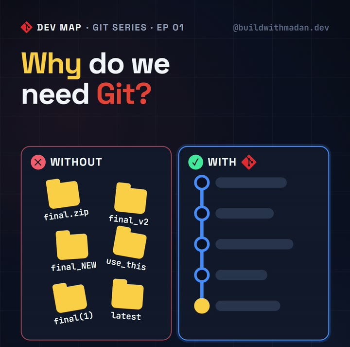
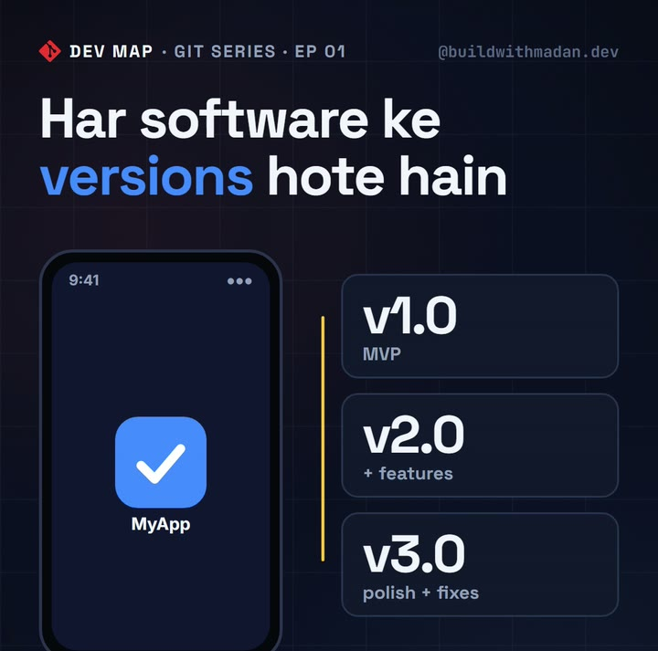
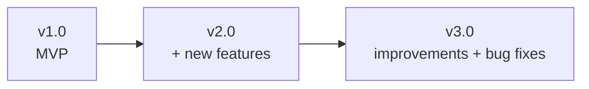
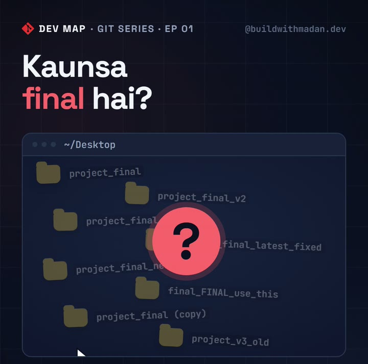
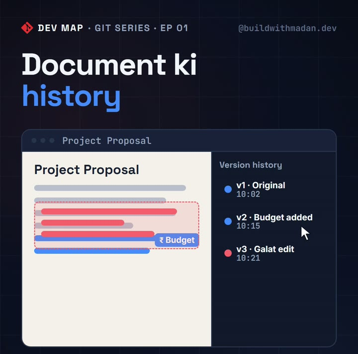
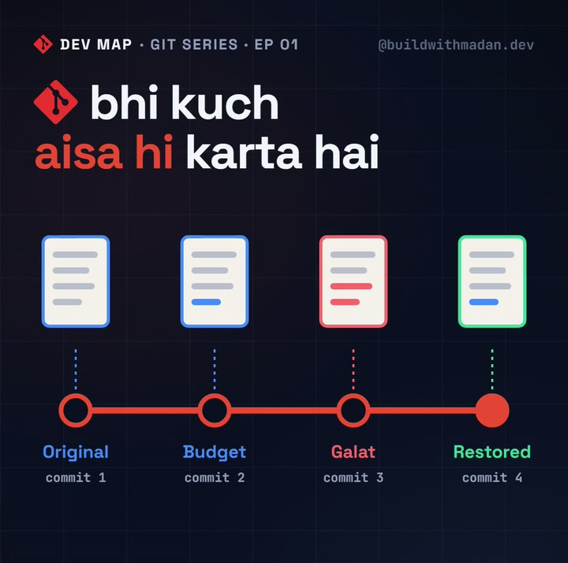
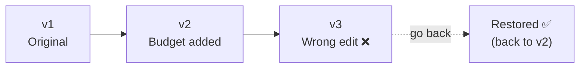
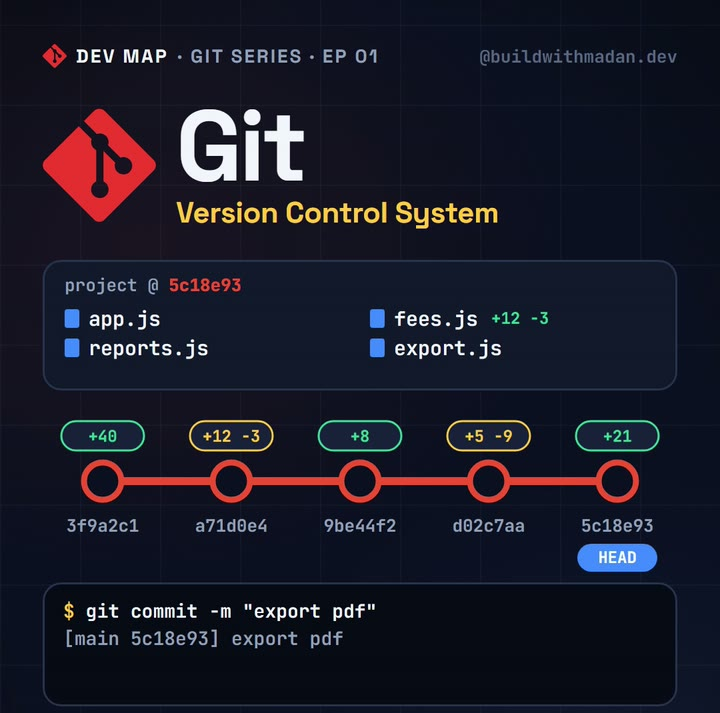
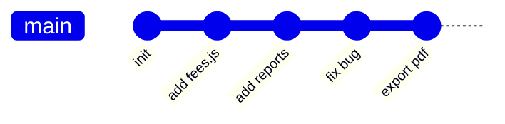
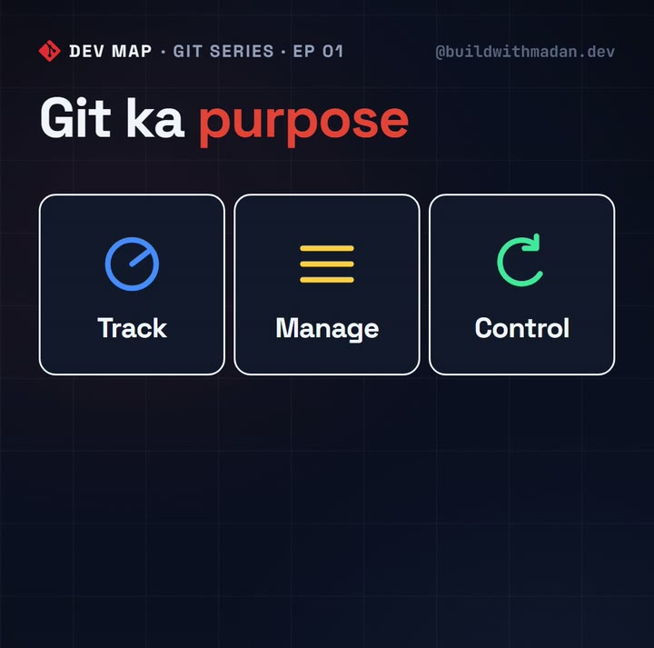

<div align="center">

# 🗺️ Dev Map · Git Series · EP 01
## What is Git?

**Notes for the reel by [@buildwithmadan.dev](https://instagram.com/buildwithmadan.dev)**

*Think beyond code.*

</div>

---

## 📑 Contents

1. [Why do we even need Git?](#1-why-do-we-even-need-git)
2. [Software has versions](#2-software-has-versions)
3. [Developers save snapshots too](#3-developers-save-snapshots-too)
4. [The problem: manual copies](#4-the-problem-manual-copies)
5. [A simple example: document history](#5-a-simple-example-document-history)
6. [So, what is Git?](#6-so-what-is-git)
7. [Key terms](#7-key-terms)
8. [The purpose of Git](#8-the-purpose-of-git)
9. [Quick recap](#9-quick-recap)
10. [Bonus: your first Git commands](#10-bonus-your-first-git-commands)
11. [What's next](#11-whats-next)

---

## 1. Why do we even need Git?

Software was being built long before Git (2005) and GitHub (2008) existed. So why did developers need these tools at all?

Because as a project grows, **keeping track of changes by hand becomes impossible.**

<p align="center"></p>

| ❌ Without Git | ✅ With Git |
|---|---|
| `final.zip`, `final_v2`, `final_NEW`, `use_this`… | One project folder |
| No idea which copy is the latest | A clear, ordered history of every change |
| Going back = digging through old folders | Going back = one command |

---

## 2. Software has versions

Whenever you install or update an app, you see a **version number**: `1.0`, `2.0`, `3.0`…

<p align="center"></p>

That's because software is rarely released as a finished product in one go:



- **MVP (Minimum Viable Product)**: the first, smallest version that actually works.
- Every later version adds **features**, **improvements** and **bug fixes**.

---

## 3. Developers save snapshots too

The same idea applies *inside* development. While building, developers save **snapshots** of their code at different stages.

<p align="center"></p>

For example:

1. ✅ Finish feature 1 → save a snapshot
2. ✅ Add feature 2 → save another snapshot
3. 🐞 Fix some bugs → save another snapshot

Very quickly, you have **many versions of the same code.**

---

## 4. The problem: manual copies

If you manage these versions by hand, your Desktop ends up like this:

<p align="center"></p>

```text
📁 project_final
📁 project_final_v2
📁 project_final_latest
📁 project_final_latest_fixed
📁 final_FINAL_use_this
📁 project_final (copy)
```

**Which one is the real final?** 🤯
Managing versions manually is slow, confusing and error-prone, and it gets much worse in a team.

---

## 5. A simple example: document history

Imagine you're working on an important document:

<p align="center"></p>

1. Before making changes, you **save a copy**.
2. You make changes and save again.
3. If the new changes turn out **wrong**, you **go back** to the previous saved copy.

<p align="center"></p>



👉 **Git works in a very similar way for your code.**

---

## 6. So, what is Git?

> **Git is a Version Control System (VCS).**
> It tracks the changes in your code, records snapshots through **commits**, and helps you go back to previous versions whenever you need to.

<p align="center"></p>

In simple words: **with Git, you can manage the complete history of your project.**

Here is what a project's history looks like in Git:



Every dot is a **commit**, a saved snapshot of your whole project at that moment.

---

## 7. Key terms

| Term | Meaning |
|---|---|
| **Version Control System (VCS)** | A tool that records changes to files over time so you can recall any version later. |
| **Git** | The most widely used VCS. It is free, open source and runs on your own computer. |
| **Repository (repo)** | A project folder that Git is tracking, together with its full history. |
| **Commit** | A snapshot of your project at a point in time, with a message describing what changed. |
| **Commit hash** | A unique ID for each commit, e.g. `5c18e93`. |
| **HEAD** | A pointer to the commit you are currently on (usually the latest one). |
| **History / log** | The ordered list of all commits in a repo. |

---

## 8. The purpose of Git

<p align="center"></p>

The basic purpose of Git is:

| Purpose | Of what | Question it answers |
|---|---|---|
| 🔵 **Tracking** | changes in your code | *What changed, when, and why?* |
| 🟡 **Managing** | changes in your code | *Keep every version organised in one place* |
| 🟢 **Controlling** | changes in your code | *Go back to any earlier version safely* |

---

## 9. Quick recap

- ✅ Software is built in **versions**: MVP → features → improvements → bug fixes.
- ✅ Developers save **snapshots** of code at every stage.
- ❌ Managing those snapshots with **manual copies** quickly becomes chaos.
- ✅ **Git** is a **Version Control System** that tracks changes, saves snapshots as **commits**, and lets you **go back** to earlier versions.
- ✅ Git = **tracking, managing and controlling changes in your code.**

---

## 10. Bonus: your first Git commands

> Not covered in the reel. This is just a preview so you can try it yourself.

```bash
git --version                   # check that Git is installed
git init                        # start tracking the current folder
git add .                       # stage all changes for the next snapshot
git commit -m "first feature"   # save a snapshot (a commit)
git log --oneline               # see the history of commits
```

Download Git: <https://git-scm.com/downloads>

---

## 11. What's next

**EP 02: What is GitHub?** We'll see how Git and GitHub are different, and how teams work together on the same project.

<div align="center">

---

Found this helpful? ⭐ **Star this repo** and follow **[@buildwithmadan.dev](https://instagram.com/buildwithmadan.dev)** for the full Dev Map series.

**This is Dev Map. Think beyond code.**

<sub>Git logo by Jason Long, licensed under CC BY 3.0.</sub>

</div>
